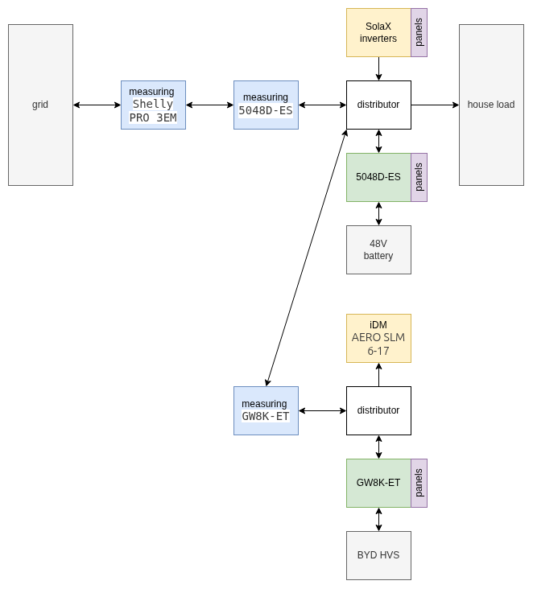

# solar-monitor

* Using GoodWe hybrid inverters, because they are able to work with negative house load - in my case energy from other inverters
* Want to avoid cloud usage, the SolaX inverters are measured by cheap Shelly PM Mini G3
* Connected heat pump to Shelly PRO 3EM, as I want to make use of solar surplus as early as possible (https://github.com/robertdiers/shelly_idmpump)

## Setup:
* GoodWe GW8K-ET inverter (HV)
* BYD HVS storage
* iDM Heat Pump AERO SLM 6-17 with "solar input" feature
* multiple Solax Mini inverters (power metered by Shelly PM Mini G3)
* GoodWe 5048D-ES inverter (48V)
* 48V battery block with Daly BMS (3 blocks in parallel)
* Tasmota device with temperature sensor (Sonoff TH16 + DS18B20)
* Shelly PRO 3EM smart meter (grid entry point)
* Device to run the containers



## main Python scripts (startup and cron triggered):
* init.py - initializes TimescaleDB tables as they are removed when device restarts
* daly-subscribe.py - subscribes to DALY MQTT output and store to database (https://github.com/softwarecrash/DALY-BMS-to-MQTT)
* emdata-subscribe.py - reads the Shelly Pro 3EM energy counters every 5 minutes (one MQTT message per run) and stores counters and daily values
* solar-monitor.py - collect metrics and store to database (grid from Shelly Pro 3EM and one message per Shelly PM Mini per run, both via short-lived MQTT clients)

## additional Python modules
* BYD.py - read actual values from BYD battery (TCP Socket)
* Config.py - read config file and check for environment parameter overrides
* Daly.py - subscribes to MQTT topic to read data
* Goodwe.py - read actual values from Goodwe inverter (SEMS Portal API) - UNUSED
* Goodwe_Local.py - read actual values from Goodwe inverter (python package), grid values are now read from Shelly Pro 3EM
* IdmPump.py - read actual solar power from iDM heat pump (TCP Modbus)
* Shelly.py - subscribes to MQTT topic to read data
* Solax.py - read actual values from Solax inverter (Solax Portal API) - UNUSED
* Tasmota.py - read Tasmota data (MQTT)
* TimescaleDb.py - write to TimescaleDB

## Docker Compose

please override config values using environment variables (see python/solar-monitor.ini)

```
services:
    solarmonitor:
        image: ghcr.io/robertdiers/solar-monitor:latest
        container_name: solarmonitor
        restart: always
        environment:
        - MQTT_BROKER=brokerip
        - MQTT_PASSWORD=brokerpassword
        - GRID_MQTT_NAME=shellypro3em-fce8c0d97c10/status/em:0
        - EMDATA_MQTT_NAME=shellypro3em-fce8c0d97c10/status/emdata:0
        - TIMESCALEDB_IP=databaseip
        - TIMESCALEDB_PASSWORD=databasepassword
        - BYD_IP=bydip
        - IDM_IP=idmip
        - GOODWE_IP_HV=goodweip_hv
        - GOODWE_IP_48=goodweip_48v
```

The grid values are read from the Shelly Pro 3EM topic once per minute (3 MQTT
messages averaged) and stored in the `watts` table as `shellypro3em_grid`,
`shellypro3em_grid_l1`, `shellypro3em_grid_l2` and `shellypro3em_grid_l3`.
Negative values mean feed-in. The former `goodwe_*_grid*` values are no longer
written. The nine Shelly PM Mini topics (`shelly1_*` … `shelly9_*`) are read in
the same cron run with short-lived clients; each client waits only for the next
message, so only one value per device and minute is stored.

The energy counters from `emdata:0` (`total_act` and `total_act_ret`) are stored
every 5 minutes by `emdata-subscribe.py` as `shellypro3em_energy_import` and
`shellypro3em_energy_export`: the counter goes to `kilowatthours_day_counter`,
the difference to the counter stored yesterday is written to `kilowatthours`
and `kilowatthours_day` (as with the other kWh values). Shelly reports these
counters in Wh; they are divided by 1000 before storing. Existing rows are
converted once on container startup by `init.sql` (tracked in
`schema_migrations`).

### TimescaleDB (please define your own password)

Using tmpfs to store data in memory, disc doesn't have to store it:

```
services:
  timescaledb:
    image: docker.io/timescale/timescaledb:latest-pg14
    container_name: timescaledb
    restart: always
    ports:
      - 5432:5432
    environment:
      - POSTGRES_PASSWORD=yourpassword 
    tmpfs:
      - /var/lib/postgresql/data
```

### Grafana

Dashboard JSON is placed in this repo:

```
services:
    grafana:
        image: docker.io/grafana/grafana:latest
        container_name: grafana
        restart: always
        ports:
        - 3000:3000
        volumes:
        - ${PWD}/grafanadata:/var/lib/grafana
```

### Mosquitto (MQTT broker, please define your config and password file once)

https://be-jo.net/2024/01/mqtt-broker-mosquitto-als-docker-container-installieren/

mosquitto.conf

```
persistence false
log_dest stdout
password_file /mosquitto/config/mosquitto.passwd
allow_anonymous false
listener 1883
```

container:

```
services:
  mosquitto:
      image: docker.io/eclipse-mosquitto:latest
      container_name: mosquitto
      restart: always
      volumes:
        - folderwithyourconfigandpasswordfile:/mosquitto/config
      ports:
        - 1883:1883
        - 9001:9001
```

after running the container you can create your own user and password using this command - than restart the container:

```
mosquitto_passwd -c /mosquitto/config/mosquitto.passwd youruser
```
